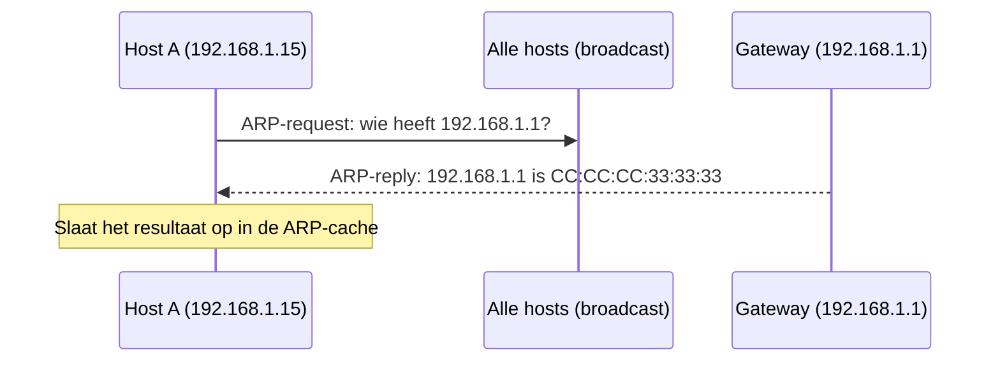

# IP-Adressering & Connectiviteit

Fundamenten van IPv4-adressering, routering en het Address Resolution Protocol (ARP) voor netwerkbeheer en triage.

## Theorie & Concepten

### IPv4 Structuur
IPv4 gebruikt 32-bit adressen in vier octetten (0-255). Het subnetmasker bepaalt welk deel het netwerk identificeert en welk deel de host.
- **Netwerkdeel:** Gemarkeerd door `255` in het masker (bijv. `/24` of `255.255.255.0`).
- **Hostdeel:** Gemarkeerd door `0` in het masker.

### Default Gateway
Voor communicatie buiten het eigen subnet is een router (default gateway) nodig. Zonder correcte gateway-configuratie kan een host alleen lokale apparaten bereiken.

### Address Resolution Protocol (ARP)

ARP vertaalt Layer 3 IP-adressen naar Layer 2 MAC-adressen.
1. **Request:** Broadcast ("Wie heeft IP X?").
2. **Reply:** Unicast ("Ik ben X, hier is mijn MAC").
3. **Cache:** Resultaat wordt tijdelijk opgeslagen om netwerkverkeer te beperken.

::: tip SOC Insight
Meerdere IP-adressen die naar hetzelfde MAC-adres verwijzen in de ARP-cache kunnen duiden op **ARP Spoofing** (Man-in-the-Middle).
:::

## Commands

### Netwerkinterfaces
Gebruik `ip a` voor een gedetailleerd overzicht van interfaces en IP-adressen. `ifconfig` is verouderd maar komt nog voor op oudere systemen.

<<< @/snippets/bash/network.sh#network-config{bash}

### Routering & ARP
De routeringstabel toont de *default gateway*. De ARP-cache bevat de koppelingen tussen IP- en MAC-adressen binnen het lokale subnet.

<<< @/snippets/bash/network.sh#network-config{bash}

### Connectiviteit testen
Test de verbinding stapsgewijs: lokale gateway, extern IP, en tenslotte DNS-naam.

<<< @/snippets/bash/network.sh#dns{bash}

## Scenarios

### Netwerk Troubleshooting
Volg deze volgorde bij verbindingsproblemen:
1. **Lokaal:** Heeft de interface een IP? (`ip a`)
2. **Gateway:** Staat de default gateway in de tabel? (`ip route`)
3. **Punt-naar-punt:** Is de gateway bereikbaar? (`ping <gateway-ip>`)
4. **Extern:** Is een extern adres bereikbaar? (`ping 8.8.8.8`)

### ARP-analyse
- **Lokaal verkeer:** ARP-request gaat direct naar de doelhost.
- **Extern verkeer:** De host doet een ARP-request voor de **MAC van de gateway**, niet de uiteindelijke bestemming. De router handelt de rest af.
