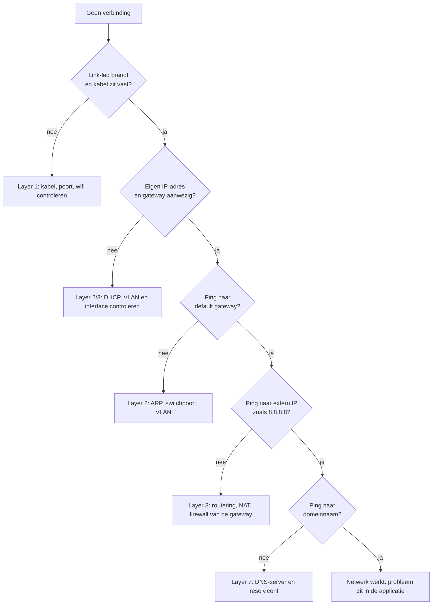

# Netwerk Troubleshooting Fundamenten

Een gestructureerde aanpak voor het diagnosticeren en oplossen van netwerkproblemen, van fysieke verbindingen tot DNS-resolutie.

## Troubleshooting Methode

Volg de OSI-lagen van beneden naar boven om de oorzaak te isoleren:

### Layer 1: Physical
- **Check:** Branden de lampjes op de netwerkkaart? Is de kabel aangesloten?
- **Actie:** Vervang kabels, test andere poorten op de switch.

### Layer 2: Data Link (MAC & VLAN)
- **Check:** Kan ik andere hosts in hetzelfde subnet pingen?
- **Actie:** Controleer de ARP-cache (`arp -a`). Controleer of de switchpoort in het juiste VLAN zit.

### Layer 3: Network (IP, DHCP & DNS)
- **Check:** Heb ik een IP-adres? Klopt de default gateway?
- **DHCP:** Vernieuw de lease als er geen of een foutief (APIPA) IP-adres is.
- **DNS:** Controleer `/etc/resolv.conf`. Staat de juiste nameserver ingesteld?

## Commands

### Connectiviteit & Routing
Gebruik `ping` voor basisbereikbaarheid en `traceroute` om bottlenecks in het pad naar de bestemming op te sporen.

<<< @/snippets/bash/network.sh#dns{bash}

### Interface & IP Inspectie
<<< @/snippets/bash/network.sh#network-config{bash}

### DNS & Naamresolutie
Als pingen op IP werkt maar op naam niet, ligt het probleem bij de DNS-configuratie.

<<< @/snippets/bash/network.sh#dns{bash}

## Scenarios

### Geen Internet (Linux)
1. **IP Check:** `ip a` (Heb ik een adres?)
2. **Gateway Check:** `ip route` (Is de gateway bekend?)
3. **Ping Gateway:** `ping <gateway-ip>` (Is de router bereikbaar?)
4. **Ping Extern IP:** `ping 8.8.8.8` (Werkt internet?)
5. **Ping Naam:** `ping google.com` (Werkt DNS?)

### DHCP & DNS op pfSense
- **DHCP Server:** Controleer of de pool groot genoeg is en de juiste gateway/DNS meegeeft.
- **DNS Resolver:** Zorg dat de service actief is en lokale hostnames (A-records) correct zijn geregistreerd.

### IPsec VPN Tunnels
Als verbindingen tussen locaties wegvallen:
- Controleer de status van **Phase 1** (Security Association) en **Phase 2**.
- Herstart de tunnel indien de status op *Disconnected* staat.

::: tip DNS Search Domain
Door een `search` domein toe te voegen in `/etc/resolv.conf` (bijv. `search bedrijf.local`), kun je servers bereiken via hun korte naam (`FILESERVER`) in plaats van de volledige FQDN.
:::
