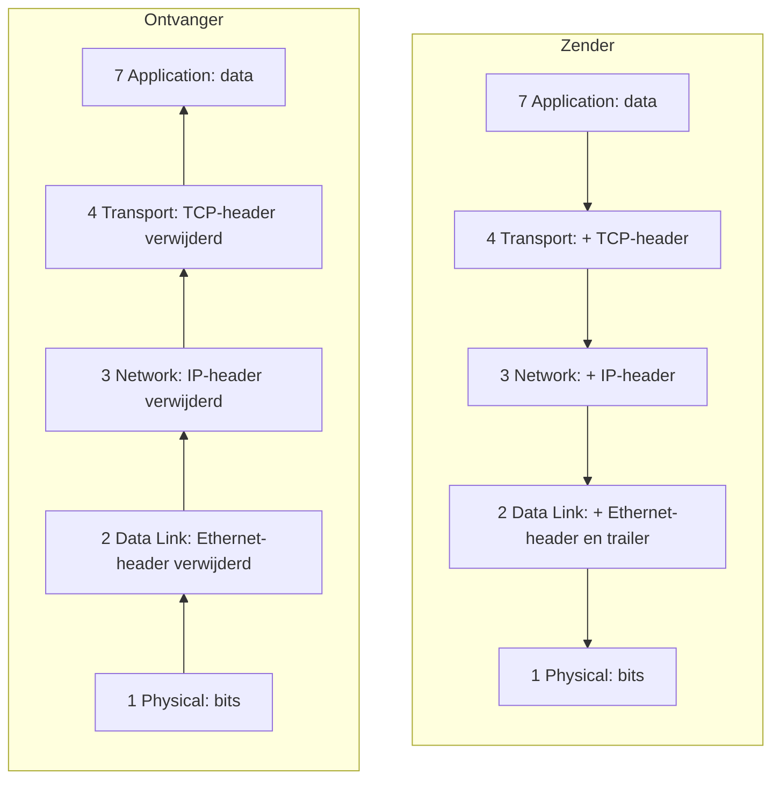

# Het OSI-model

Het OSI-model (*Open Systems Interconnection*) verdeelt netwerkcommunicatie in zeven lagen. Het is het referentiekader voor troubleshooting en analyse: je benoemt op welke laag een probleem of aanval zich afspeelt en weet daarmee welk gereedschap past.

## De zeven lagen

| Layer | Naam | PDU | Functie | Adressering | Voorbeelden |
| :--- | :--- | :--- | :--- | :--- | :--- |
| 7 | Application | Data | Interface voor applicaties en protocollen | URL, hostnaam | HTTP, DNS, SMTP, SSH |
| 6 | Presentation | Data | Formattering, encryptie, compressie | n.v.t. | TLS, JPEG, ASCII |
| 5 | Session | Data | Sessies opzetten, onderhouden en afsluiten | n.v.t. | RPC, NetBIOS-sessies |
| 4 | Transport | Segment (TCP) / datagram (UDP) | Betrouwbaarheid, flow control en poorten | Poortnummers | TCP, UDP |
| 3 | Network | Pakket | Routering tussen netwerken | IP-adres | IP, ICMP, IPsec |
| 2 | Data Link | Frame | Levering binnen het lokale netwerk | MAC-adres | Ethernet, ARP, 802.1Q |
| 1 | Physical | Bits | Overdracht van signalen | n.v.t. | Koper, glasvezel, Wi-Fi |

::: tip Ezelsbruggetjes
- **7 naar 1:** **A**lle **P**rima **S**ystemen **T**ransporteren **N**etjes **D**e **F**rames.
- **1 naar 7:** **P**lease **D**o **N**ot **T**hrow **S**ausage **P**izza **A**way.
:::

## Wat gebeurt er per laag

### Layer 7: Application
De applicatie vertaalt een actie naar een protocolverzoek, bijvoorbeeld `GET /index.html HTTP/1.1`.

### Layer 6: Presentation
Zorgt dat data leesbaar en veilig is voor de ontvanger. Hier vallen encryptie (TLS), compressie en tekencodering onder.

### Layer 5: Session
Beheert de dialoog tussen twee systemen: opzetten, onderhouden en netjes afsluiten van een sessie.

### Layer 4: Transport
Knipt data in **segmenten** (TCP) of **datagrammen** (UDP) en voegt poortnummers toe, zoals 443 voor HTTPS. TCP zorgt voor volgorde en herhaling bij verlies.

### Layer 3: Network
Bepaalt de route door het netwerk. Data wordt een **pakket** met bron- en doel-IP-adres.

### Layer 2: Data Link
Levert frames tussen direct verbonden apparaten op het lokale netwerk. Hier worden MAC-adressen gebruikt.

### Layer 1: Physical
Zet bits om in elektrische signalen, lichtpulsen of radiogolven.

## Encapsulation en decapsulation

- **Encapsulation (zenden):** de data gaat van layer 7 naar layer 1. Elke laag voegt een eigen **header** toe, en layer 2 ook een **trailer**.
- **Decapsulation (ontvangen):** de data gaat van layer 1 naar layer 7. Elke laag leest zijn eigen header, verwijdert die en geeft de rest door.

### Het pakket van laptop tot webserver

<PacketWizard />

## OSI in de praktijk van een SOC

| Layer | Wat je daar onderzoekt | Typisch gereedschap |
| :--- | :--- | :--- |
| 7 | Verdachte URL's, DNS-queries, user-agents | Proxy-logs, SIEM, Wireshark |
| 6 | Certificaten, TLS-versies | `openssl`, Wireshark |
| 4 | Open poorten, scans, SYN-floods | Nmap, firewalllogs |
| 3 | IP-reputatie, routing, geo-afwijkingen | `ping`, `traceroute`, firewalls |
| 2 | ARP-spoofing, MAC-flooding, VLAN-hopping | Switchlogs, `arp`, Wireshark |
| 1 | Kabelbreuk, signaalverlies | Fysieke controle |

## Further reading

- [TCP/IP-model](/networking/tcp-ip-model): het praktische model waarop het internet draait.
- [Packet Lifecycle](/networking/packet-lifecycle): één HTTP-verzoek van klik tot server, laag voor laag.
- [Network Troubleshooting](/networking/network-troubleshooting-basics): de lagen als diagnosemethode.
