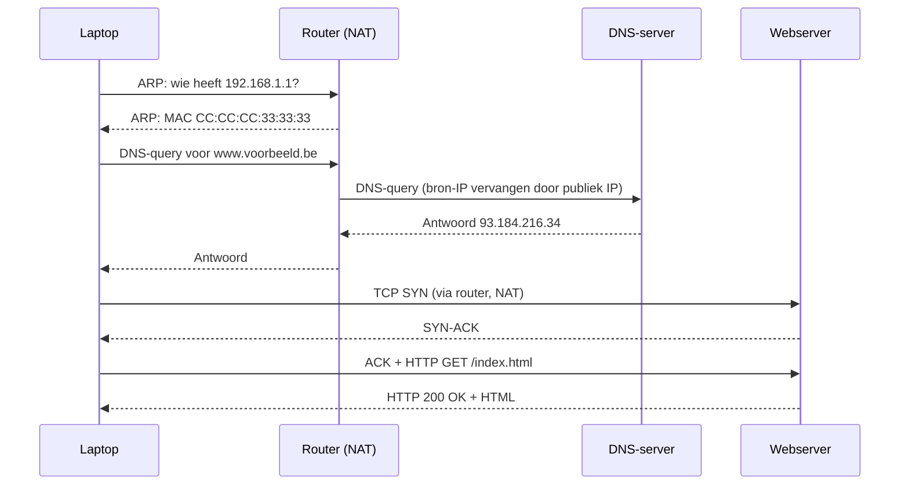

# Packet Lifecycle: van klik tot server

Een stap-voor-stap uitwerking van het pad van een HTTP-aanvraag (`http://www.voorbeeld.be/index.html`), van de eerste klik tot de verwerking door de server.

## De Opstelling

| Entiteit | IP-adres | MAC-adres | Rol |
| :--- | :--- | :--- | :--- |
| **Laptop** | `192.168.1.15` | `AA:AA:AA:11:11:11` | Client |
| **Router** | `192.168.1.1` | `CC:CC:CC:33:33:33` | Gateway & NAT |
| **DNS-Server** | `195.130.130.1` | *(Extern)* | Naamresolutie |
| **Webserver** | `93.184.216.34` | *(Extern)* | Bestemming |

## Voorbereidende Fasen

### DNS Resolutie
Voordat er data verzonden kan worden, moet de laptop het IP van `www.voorbeeld.be` weten.
1. De laptop stuurt een **DNS Query** (UDP poort 53).
2. De router doet NAT (bron-IP wordt publiek IP).
3. De laptop ontvangt het antwoord: `93.184.216.34`.

### ARP (Address Resolution Protocol)
De laptop vergelijkt het doel-IP met zijn eigen subnet. Omdat de server extern is, moet het pakket naar de **Default Gateway**.
1. De laptop stuurt een **ARP Broadcast** ("Wie heeft 192.168.1.1?").
2. De router antwoordt met zijn MAC-adres (`CC:CC:CC:33:33:33`).

## Encapsulation op de Client

1. **L7 (Application):** De browser maakt het HTTP-verzoek: `GET /index.html HTTP/1.1`.
2. **L4 (Transport):** Er wordt een **TCP 3-way handshake** (`SYN` -> `SYN-ACK` -> `ACK`) uitgevoerd. De data krijgt een TCP-header met bronpoort (bijv. 51432) en doelpoort (80).
3. **L3 (Network):** De IP-header wordt toegevoegd met bron `192.168.1.15` en doel `93.184.216.34`. De **TTL** wordt ingesteld (bijv. 64).
4. **L2 (Data Link):** Het pakket wordt verpakt in een **Ethernet Frame** met bron-MAC van de laptop en doel-MAC van de **router**.
5. **L1 (Physical):** De netwerkkaart zet de bits om in elektrische of optische signalen.

## De Reis (Routing & NAT)

### De Router
1. **L2 stripping:** De router ontvangt het frame en verwijdert de Ethernet-header.
2. **Routing:** Het doel-IP is extern. De router verlaagt de **TTL** met 1.
3. **NAT:** De router vervangt het private bron-IP door zijn publieke IP en past de bronpoort aan in de NAT-tabel.
4. **Nieuwe L2:** Het pakket krijgt een nieuwe Ethernet-header richting de ISP.

### Het Internet
Bij elke router (*hop*) onderweg:
- De L2-header wordt vervangen.
- De **TTL** wordt met 1 verlaagd.
- De IP-adressen (L3) blijven ongewijzigd.

## Aankomst & decapsulation

Bij de webserver wordt het proces omgedraaid:
1. **L2:** De netwerkkaart controleert het MAC-adres en verwijdert de Ethernet-header.
2. **L3:** De IP-stack ziet dat het IP-adres klopt en verwijdert de IP-header.
3. **L4:** TCP ziet poort 80 en levert de data af bij de webserver-software (Nginx/Apache).
4. **L7:** De webserver verwerkt de `GET`-aanvraag en bereidt de HTML-respons voor.

::: info Response Path
De terugweg volgt hetzelfde proces in omgekeerde volgorde, waarbij de router via de NAT-tabel de pakketten weer bij de juiste interne laptop aflevert.
:::

## Het pakket stap voor stap

Volg het HTTP-verzoek van de laptop naar de webserver. Bij elke stap zie je het pakket met zijn headers: wat wordt toegevoegd, gewijzigd of verwijderd, en waar het zich bevindt.

<PacketWizard />

## Further reading

- [Het OSI-model](/networking/osi-model) en [het TCP/IP-model](/networking/tcp-ip-model) voor de theorie achter elke stap.
- [IP-adressering](/networking/ip-addressing-basics) voor ARP, subnets en de default gateway.
