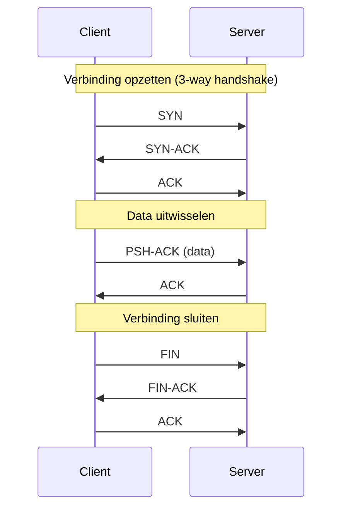

# Het TCP/IP-model

Het TCP/IP-model (ook *Internet protocol suite*) is het praktische model waarop het internet is gebouwd. Het kent vier lagen en is minder gedetailleerd dan het [OSI-model](/networking/osi-model), maar het beschrijft de protocollen die je echt in captures en logs tegenkomt.

## De vier lagen

| TCP/IP-laag | OSI-lagen | PDU | Functie | Protocollen |
| :--- | :--- | :--- | :--- | :--- |
| **Application** | 5, 6, 7 | Data | Applicatieprotocollen, encryptie, sessies | HTTP, HTTPS, DNS, SMTP, SSH, DHCP |
| **Transport** | 4 | Segment / datagram | Poortgebaseerde communicatie tussen processen | TCP, UDP |
| **Internet** | 3 | Pakket | Logische adressering en routering | IP, ICMP, IPsec |
| **Network Access** | 1, 2 | Frame / bits | Levering op het lokale netwerk en fysieke overdracht | Ethernet, Wi-Fi, ARP |

## Vergelijking met OSI

| Aspect | OSI | TCP/IP |
| :--- | :--- | :--- |
| Aantal lagen | 7 | 4 |
| Karakter | Theoretisch referentiemodel | Praktisch model achter het internet |
| Gebruik | Troubleshooting en onderwijs | Implementatie van protocollen |
| Sessie en presentatie | Eigen lagen | Onderdeel van Application |

::: info
In de praktijk gebruik je beide: TCP/IP voor wat een protocol doet, OSI layer numbers voor het benoemen van een probleem ("dit is een layer 2-probleem").
:::

## Encapsulation in TCP/IP

Elke laag voegt een header toe aan de data van de laag erboven:

1. **Application:** de applicatie levert data, bijvoorbeeld een HTTP-verzoek.
2. **Transport:** TCP of UDP voegt bron- en doelpoort toe.
3. **Internet:** IP voegt bron- en doel-IP-adres toe, plus de TTL.
4. **Network Access:** Ethernet voegt MAC-adressen toe en een trailer met een checksum.

De ontvanger doorloopt dezelfde stappen in omgekeerde volgorde. Zie [Packet Lifecycle](/networking/packet-lifecycle) voor een uitgewerkt voorbeeld.

## TCP en UDP

| Eigenschap | TCP | UDP |
| :--- | :--- | :--- |
| Verbinding | Connection-oriented (3-way handshake) | Connectionless |
| Betrouwbaarheid | Bevestiging, herhaling en volgorde | Geen garanties |
| Snelheid | Trager door overhead | Snel |
| Typisch gebruik | HTTP(S), SSH, SMB, e-mail | DNS, DHCP, streaming, VoIP |

De vlaggen en poortnummers staan in [Poorten & Protocollen](/networking/ports-and-protocols).

## Analyse in Wireshark

Wireshark toont de lagen van een pakket in omgekeerde volgorde: de laagste laag staat bovenaan, de applicatiedata onderaan.

| Filter | Doel |
| :--- | :--- |
| `tcp` | Al het TCP-verkeer, inclusief ingekapselde HTTP |
| `http.request` | Alleen uitgaande HTTP-verzoeken |
| `ip.addr == 192.168.0.1` | Verkeer van of naar één adres |
| `tcp.port == 80` | Verkeer op poort 80 |

Meer filters staan op [Wireshark Basics](/tools/wireshark-basics).

::: tip PDU-terminologie
Op layer 4 spreek je over **segmenten**, op layer 3 over **pakketten** en op layer 2 over **frames**.
:::
