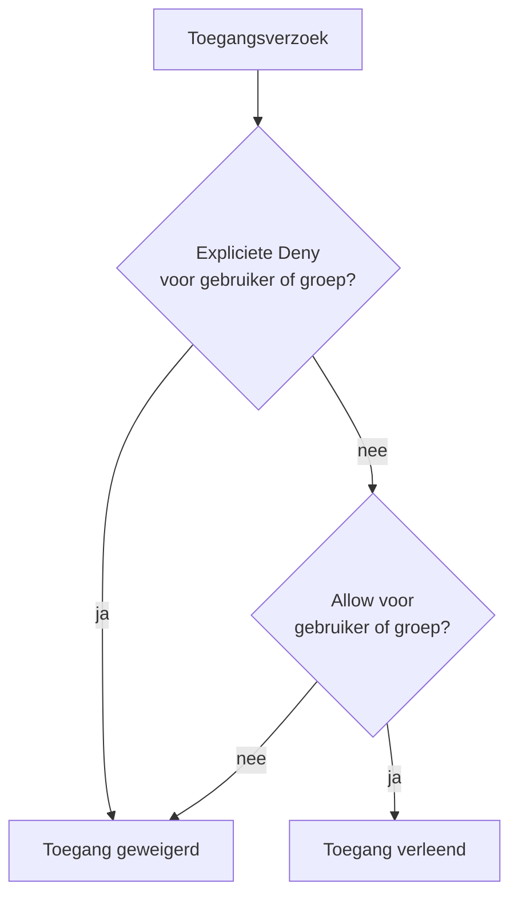

# Access Control

Access control bepaalt wie met welke rechten bij welke resource mag. Het is de basis van het *least privilege*-principe en de eerste plek om te kijken bij misbruik van rechten.

## Concepts

### Autorisatiemodellen

| Model | Kenmerk | Gebruik |
| :--- | :--- | :--- |
| **MAC** (*Mandatory*) | Strenge labels voor classificatie en categorie, de beheerder bepaalt | Overheid en defensie |
| **DAC** (*Discretionary*) | De eigenaar wijzigt rechten per object | Standaard in Windows NTFS en Linux |
| **RBAC** (*Role-Based*) | Rechten gekoppeld aan functierollen, meestal via groepen | Bedrijfsomgevingen |

### De drie A's

1. **Authenticatie:** vaststellen wie je bent.
2. **Autorisatie:** bepalen wat je mag.
3. **Accounting:** vastleggen wat je gedaan hebt.

### Windows-machtigingen

| Machtiging | Betekenis |
| :--- | :--- |
| **Full Control** | Volledig beheer, inclusief rechten wijzigen |
| **Modify** | Lezen, schrijven, uitvoeren en verwijderen |
| **Read & Execute** | Lezen en uitvoeren |
| **Read** / **Write** | Alleen lezen of alleen schrijven |

::: warning Voorrangsregels
- Een expliciete **Deny** wint altijd van **Allow**.
- Rechten worden **overgeërfd** van de bovenliggende map, tenzij overerving is uitgeschakeld.
- De effectieve rechten van een gebruiker zijn de som van alle groepen waar die lid van is.
:::

### Linux-rechten

`chmod 750` leest als eigenaar `rwx`, groep `r-x`, anderen `---`. Een uitgebreider overzicht staat bij [Linux File System](/linux/linux-file-system-basics).

## Commands

Parameters en uitleg staan in de referenties: [icacls](/scripting/cmd#cmd-icacls), [Get-Acl](/scripting/powershell#ps-get-acl-get-localgroupmember) en [chmod, chown & getfacl](/scripting/bash#sh-permissies).

::: code-group

<<< @/snippets/cmd/access-control.bat#icacls{cmd} [icacls]

<<< @/snippets/ps/access-control.ps1#acl{powershell} [Get-Acl]

<<< @/snippets/bash/file.sh#permissions{bash} [chmod]

:::

## SOC use

- Onverwachte wijzigingen in rechten op systeemmappen kunnen wijzen op persistence.
- Leden van `Administrators` of `Domain Admins` horen op een korte, bekende lijst te staan.
- Zie [Windows Services](/windows/windows-services) voor misbruik van servicepaden en [Active Directory](/windows/active-directory-basics) voor groepsstrategie (AGDLP).
