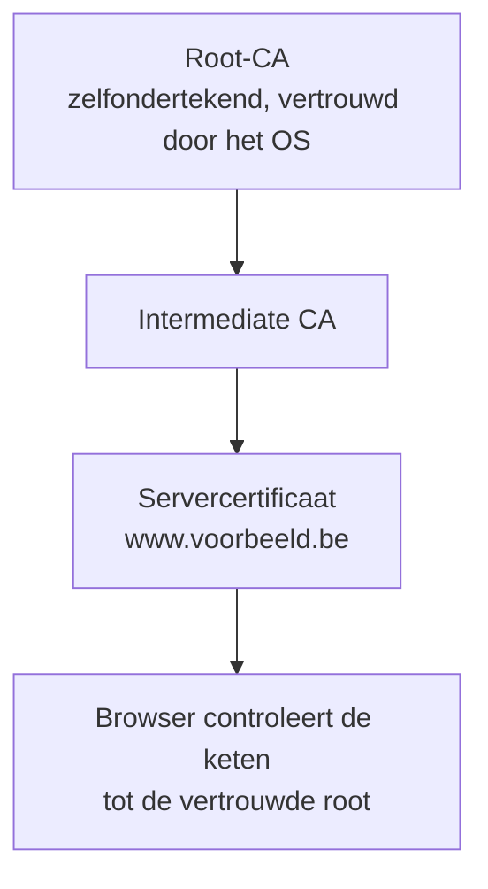

# Asymmetric Cryptography

Asymmetrische cryptografie gebruikt een key pair: een publieke sleutel die je deelt en een private sleutel die je geheimhoudt. Wat met de ene sleutel wordt gedaan, kan alleen met de andere worden teruggedraaid.

## Concepts

### Key pairs

| Bewerking | Sleutel van de verzender | Sleutel van de ontvanger | Doel |
| :--- | :--- | :--- | :--- |
| **Versleutelen** | Publieke sleutel van de ontvanger | Eigen private sleutel | Vertrouwelijkheid |
| **Ondertekenen** | Eigen private sleutel | Publieke sleutel van de verzender | Authenticiteit en non-repudiation |

::: tip Ezelsbrug
Versleutelen doe je met de **publieke** sleutel van de ontvanger. Ondertekenen doe je met je **eigen private** sleutel.
:::

### Algoritmen

| Algoritme | Gebruik | Opmerking |
| :--- | :--- | :--- |
| **RSA** | Versleuteling en handtekeningen | Gangbaar, minimaal 2048 bit |
| **ECC / Ed25519** | Handtekeningen, SSH-sleutels | Kortere sleutels bij gelijke sterkte |
| **Diffie-Hellman** | Key exchange | Basis van TLS-sleutelafspraak |

### PKI en certificaten

- **Digitaal certificaat:** koppelt een publieke sleutel aan een identiteit en is ondertekend door een **Certificate Authority (CA)**.
- **Public Key Infrastructure (PKI):** het geheel van CA's, certificaten en regels voor uitgifte en intrekking.
- **Chain of trust:** een certificaat wordt vertrouwd als de keten naar een vertrouwde root-CA klopt.

## Commands

Parameters staan bij [openssl](/scripting/bash#sh-openssl).

<<< @/snippets/bash/security.sh#openssl{bash}

::: details Voorbeeldscript: sleutels uitproberen
Dit script probeert een reeks versleutelde bestanden te ontsleutelen met alle beschikbare sleutels.

<<< @/snippets/bash/cryptography-keeper.sh#keeper{bash}
:::

## SOC use

- Verlopen of zelfondertekende certificaten in TLS-verkeer verdienen aandacht.
- Een private sleutel die in een repository of op een gedeelde schijf staat, moet als gecompromitteerd worden beschouwd.
