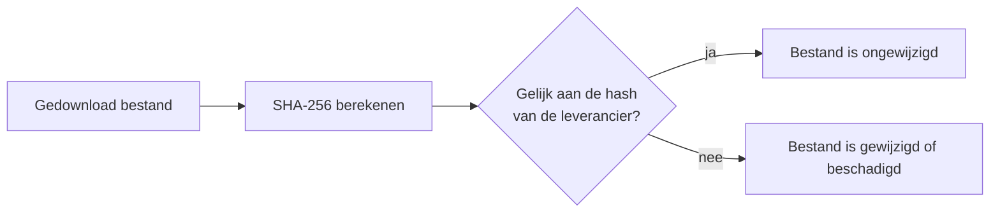

# Cryptographic Hash Functions

Een hashfunctie zet data van elke grootte om in een vaste, korte waarde: de hash of vingerafdruk. Hashes controleren integriteit en identificeren bestanden zonder de inhoud te delen.

## Concepts

### Eigenschappen

- **Deterministisch:** dezelfde invoer geeft altijd dezelfde hash.
- **Avalanche effect:** een minimale wijziging in de invoer verandert de hash volledig.
- **One-way:** uit een hash is de oorspronkelijke data niet terug te rekenen.
- **Collision resistant:** het is praktisch onmogelijk twee verschillende invoeren met dezelfde hash te vinden.

### Veelgebruikte algoritmen

| Algoritme | Lengte | Status |
| :--- | :--- | :--- |
| **MD5** | 128 bit | Onveilig tegen botsingen, nog bruikbaar voor een snelle vingerafdruk |
| **SHA-1** | 160 bit | Onveilig, uit gebruik |
| **SHA-256** | 256 bit | Standaard voor integriteit en IOC's |
| **SHA-512** | 512 bit | Sterker, grotere uitvoer |

### Toepassingen

- **File integrity:** controleren of gedownloade software ongewijzigd is.
- **Malware-analyse:** een hash opzoeken in VirusTotal zonder het bestand te uploaden.
- **Wachtwoordopslag:** wachtwoorden worden gehasht opgeslagen, bij voorkeur met *salt* en een trage functie zoals bcrypt of Argon2.
- **Digitale handtekeningen:** de hash wordt ondertekend in plaats van het hele bestand.

## Commands

Per platform staat de hash-opdracht in de referenties: [sha256sum](/scripting/bash#sh-sha256sum), [Get-FileHash](/scripting/powershell#ps-get-filehash) en [certutil](/scripting/cmd#cmd-certutil).

::: code-group

<<< @/snippets/bash/security.sh#hashes{bash} [Linux]

<<< @/snippets/ps/file.ps1#hash{powershell} [PowerShell]

<<< @/snippets/cmd/processing.bat#certutil{cmd} [CMD]

:::

## SOC use

- Vergelijk de hash van een verdacht bestand met bekende IOC's voordat je het uitvoert.
- Een andere hash dan de officiële van de leverancier wijst op een gewijzigd bestand.
