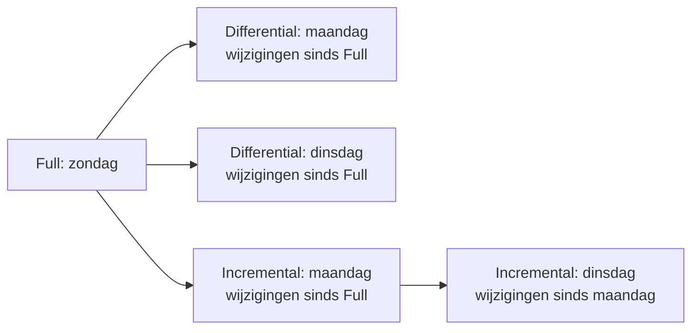

# Back-up & herstel

Back-ups bepalen hoe snel en hoe volledig een organisatie herstelt na ransomware, een storing of een incident. Ze zijn alleen waardevol als herstel getest is.

## Concepts

### Back-uptypen

| Type | Wat wordt opgeslagen | Benodigd voor herstel |
| :--- | :--- | :--- |
| **Full** | Alle geselecteerde data | Alleen de laatste full back-up |
| **Differential** | Wijzigingen sinds de laatste full back-up | Laatste full en laatste differential |
| **Incremental** | Wijzigingen sinds de vorige back-up | Laatste full en alle incrementals |
| **Bare metal** | Het volledige systeem (OS, apps en data) | Herstel naar nieuwe hardware |

### De 3-2-1-1-0-regel

| Cijfer | Betekenis |
| :--- | :--- |
| **3** | Drie kopieën van de data |
| **2** | Op twee verschillende media |
| **1** | Eén kopie extern (*offsite*) |
| **1** | Eén kopie offline of onveranderbaar (*immutable*), tegen ransomware |
| **0** | Nul fouten bij testherstel |

### Herstelmetrics

- **RPO** (*Recovery Point Objective*): hoeveel dataverlies, in tijd, is acceptabel.
- **RTO** (*Recovery Time Objective*): hoe lang mag herstel duren.

::: danger Ransomware
Back-ups die bereikbaar zijn vanaf het gecompromitteerde systeem worden vaak mee versleuteld of verwijderd. Bewaar minstens één kopie offline of immutable.
:::

## Commands

Parameters staan bij [wbadmin](/scripting/cmd#cmd-wbadmin) en [Windows Server Backup](/scripting/powershell#ps-windows-server-backup).

::: code-group

<<< @/snippets/ps/access-control.ps1#backup{powershell} [PowerShell]

<<< @/snippets/cmd/os-management.bat#backup{cmd} [wbadmin]

:::

## SOC use

- Verwijderde schaduwkopieën en back-upcatalogi zijn een typisch signaal van ransomware.
- Controleer na een incident of herstelpunten schoon zijn voordat je erop terugvalt.
