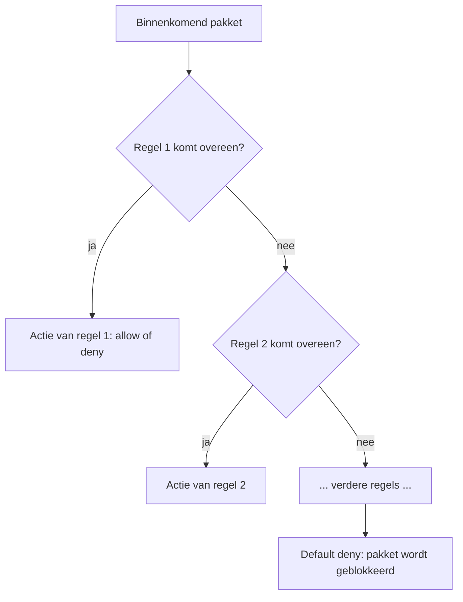

# Firewalls

Een firewall filtert netwerkverkeer op basis van regels. Ze zijn de eerste verdedigingslinie en een belangrijke logbron bij het reconstrueren van een incident.

## Concepts

### Firewalltypen

| Type | Werking | Toepassing |
| :--- | :--- | :--- |
| **Packet filtering** | Filtert op IP, poort en protocol, zonder status (stateless) | Snelle basisfilter |
| **Stateful inspection** | Houdt de status van verbindingen bij | Standaard voor moderne firewalls |
| **Application layer (WAF/proxy)** | Inspecteert de payload, zoals HTTP | Bescherming van webservers |
| **Next-generation (NGFW)** | Combineert het bovenstaande met IPS en applicatieherkenning | Perimeterbeveiliging |

### Regels en principes

- **Default deny:** wat niet expliciet is toegestaan, wordt geblokkeerd.
- **Volgorde telt:** regels worden van boven naar beneden verwerkt en de eerste match wint.
- **Inbound en outbound:** filter inkomend verkeer streng en beperk uitgaand verkeer om C2 en datalekken te bemoeilijken.
- **Minimaal openen:** open per dienst alleen de nodige poorten en bronnen.

::: tip Waar draait wat
Linux gebruikt `iptables` of `nftables`. Windows gebruikt de *Windows Defender Firewall with Advanced Security*. Netwerkapparaten zoals pfSense draaien `pf`.
:::

## Commands

Parameters staan in de referenties: [iptables & VPN](/scripting/bash#sh-iptables), [netsh](/scripting/cmd#cmd-netstat) en [Netwerkcmdlets](/scripting/powershell#ps-netwerkcmdlets).

<<< @/snippets/bash/firewall.sh#iptables{bash}

## SOC use

- Veel geweigerde pakketten van één bron wijzen op scanning, zie [Nmap](/tools/nmap-basics).
- Plotseling uitgeschakelde of aangepaste regels zijn een indicator voor aanvallers die zich verbergen.
- Zie [Poorten & Protocollen](/networking/ports-and-protocols) om geblokkeerd verkeer te duiden.
