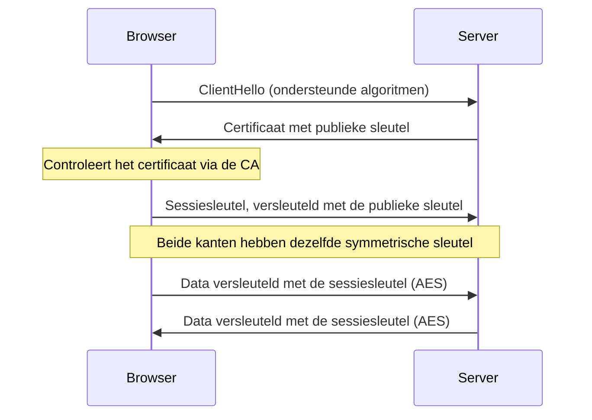

# Symmetric Cryptography

Versleuteling met één gedeelde sleutel: werking, nadelen en het gebruik in hybride systemen zoals TLS.

## Concepts

### Werking van Symmetrische Cryptografie
* **Eén gedeelde sleutel:** Symmetrische cryptografie gebruikt **één enkele cryptografische sleutel** (ook wel *secret key* of *shared secret* genoemd) om zowel *plaintext* te versleutelen als *ciphertext* te ontsleutelen.
* **Stappenplan voor veilige communicatie (User A naar User B):**
  1. User A genereert een geheime sleutel.
  2. User A deelt een kopie van deze sleutel met User B.
  3. User A versleutelt het bericht met de gedeelde sleutel en verstuurt de *ciphertext*.
  4. User B ontsleutelt de *ciphertext* met exact dezelfde gedeelde sleutel.
* **Voordelen & Toepassingen:** Symmetrische algoritmen (zoals **AES**) zijn zeer snel, rekenkundig efficiënt en uiterst veilig. Daarom vormen ze de standaard voor:
  * Bulk-data-encryptie (grote hoeveelheden bestanden of netwerkverkeer).
  * *At-rest* database- en schijfencryptie.
  * Betaaltoepassingen en financiële transacties.

### De Twee Grote Nadelen van Symmetrische Encryptie
1. **Key Management (Key management / Schaalbaarheid):**
   * Elk paar gebruikers dat privé wil communiceren zonder dat anderen kunnen meelezen, heeft een unieke gedeelde sleutel nodig.
   * Het totale aantal benodigde sleutels voor $N$ gebruikers groeit kwadratisch volgens de formule:
     $$\text{Aantal sleutels} = \frac{N \times (N - 1)}{2}$$
   * *Voorbeeld:* Voor **10 gebruikers** zijn er al $\frac{10 \times (10 - 1)}{2} = 45$ aparte geheime sleutels nodig. In grote organisaties wordt dit onbeheersbaar.
2. **Key Distribution (Sleuteldistributie):**
   * Voordat twee partijen versleuteld kunnen communiceren, moet de sleutel eerst veilig bij de ontvanger terechtkomen. Het versturen van de sleutel over een onveilig kanaal opent de deur voor onderschepping (*key theft*).

### Hybride Cryptografie (TLS / HTTPS)

* Om de snelheid van symmetrische cryptografie te combineren met veilig key management, worden symmetrische en asymmetrische cryptografie samen ingezet als een **hybride cryptografische oplossing**.
* Het bekendste voorbeeld is **TLS (Transport Layer Security)**, het protocol achter **HTTPS**: asymmetrische cryptografie wordt gebruikt om veilig een tijdelijke gedeelde sessiesleutel uit te wisselen, waarna al het daadwerkelijke webverkeer razendsnel met symmetrische encryptie wordt beveiligd.

## Commands

De commando's voor dit onderwerp staan in de referentiepagina's, met parameters en voorbeelden:

- [openssl genpkey](/scripting/bash#sh-openssl)
- [openssl pkeyutl](/scripting/bash#sh-openssl)
- [base64](/scripting/bash#sh-base64)
- [su](/scripting/bash#sh-whoami)
- [mail](/scripting/bash#sh-mail)

## Scenarios

### Scenario 1: Een Gedeelde Sleutel Aanmaken, Uitwisselen en Gebruiken voor Versleutelde Berichten
Dit stappenplan laat zien hoe twee lokale gebruikers (`cybrary` en `john`) een sleutel uitwisselen, binaire encryptie uitvoeren en Base64 gebruiken voor transport:

1. **Genereer en codeer de geheime sleutel (als `cybrary`):**
   <<< @/snippets/bash/symmetric.sh#sym-lab-step1{bash}
   * *Aandachtspunt:* Omdat het sturen van de sleutel via onversleutelde e-mail gebeurt, illustreert dit direct het **key distribution**-probleem uit de theorie.
2. **Wissel naar de ontvanger, ontvang en decodeer de sleutel (als `john`):**
   <<< @/snippets/bash/symmetric.sh#sym-lab-step2{bash}
   * Open bericht `1`, kopieer uitsluitend de Base64-tekst uit de berichttekst en sluit af met `exit`.
   * Sla de tekst op en decodeer deze terug naar het sleutelbestand:
<<< @/snippets/bash/symmetric.sh#sym-lab-step2-decode{bash}
3. **Versleutel een geheim bericht en verstuur het (als `john`):**
   <<< @/snippets/bash/symmetric.sh#sym-lab-step3{bash}
   * *Valkuil:* `message.enc` bevat ruwe binaire data (*gibberish*). Als je dit zonder `base64` probeert te kopiëren of te mailen, raakt het bestand beschadigd en mislukt de decryptie.
4. **Ontvang, decodeer en ontsleutel het bericht (terug als `cybrary`):**
   <<< @/snippets/bash/symmetric.sh#sym-lab-step4{bash}
   * Open bericht `2`, kopieer de Base64-payload uit de berichttekst en typ `exit`.
   * Decodeer eerst van Base64 naar binair, en ontsleutel daarna met de oorspronkelijke sleutel:
<<< @/snippets/bash/symmetric.sh#sym-lab-step4-decode{bash}

## References

* **Interne Commandoreferenties (SOC Analyst Map):**
  * Zie `BASH.md` (Sectie 4 voor `base64` en Sectie 10 voor `openssl` en cryptografie) voor de bijgewerkte Linux-commando's.
  * Zie `CMD.md` (`certutil`, `runas`) en `PowerShell.md` (`Protect-CmsMessage`, `[Convert]::ToBase64String`) voor de Windows-equivalenten.
* **Officiële Documentatie & Hulpmiddelen:**
  * [OpenSSL `genpkey` Manual](https://docs.openssl.org/master/man1/openssl-genpkey/) & [OpenSSL `pkeyutl` Manual](https://docs.openssl.org/master/man1/openssl-pkeyutl/) — Officiële documentatie van de gebruikte OpenSSL-subcommando's.
  * [NIST FIPS 197: Advanced Encryption Standard (AES)](https://csrc.nist.gov/pubs/fips/197/final) — De officiële standaard voor moderne symmetrische encryptie.
  * [RFC 8446: The Transport Layer Security (TLS) Protocol Version 1.3](https://datatracker.ietf.org/doc/html/rfc8446) — Technische specificatie van hybride cryptografie in HTTPS.
