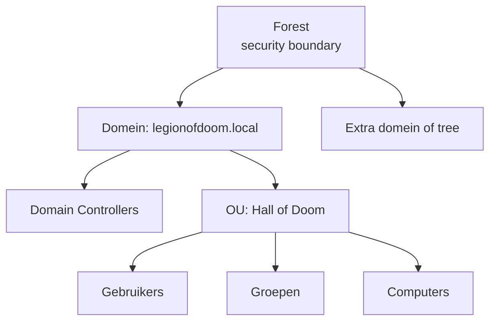
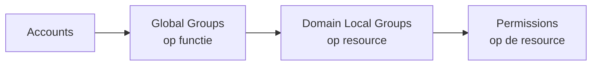

# Active Directory Basics

De opbouw van Active Directory, het opzetten van een domein en het beheren van OU's, gebruikers en groepen.

## Concepts

### Kerncomponenten van Active Directory

* **Active Directory (AD):** Een hiërarchische, gecentraliseerde database die informatie opslaat over objecten op het netwerk — zoals **users**, **groups** en **computers** — om gebruikers te identificeren en gecontroleerde toegang tot netwerkbronnen te verlenen.
* **Domain Controller (DC):** Een Windows Server waarop de **Active Directory Domain Services (AD DS)**-rol draait en die authenticatie- en autorisatiediensten levert aan gebruikers en computers binnen het domein.
* **Forest (Het hoogste niveau & Security boundary):**
  * De eerste installatie van Active Directory creëert automatisch een **forest**: het hoogste niveau in de AD-hiërarchie.
  * **Ultimate Security Boundary:** Een forest vormt de ultieme security boundary (niet het domein!). Beheerdersrechten gelden niet automatisch buiten het forest, tenzij er expliciet een *Forest Trust* wordt opgezet.
  * **Transitive Trusts:** Alle domeinen binnen hetzelfde forest vertrouwen elkaar automatisch via **transitieve vertrouwensrelaties** (*transitive trust relationships*), waardoor authenticatie tussen domeinen naadloos verloopt.
  * **Gedeelde onderdelen binnen een forest:** Alle domeinen in een forest delen hetzelfde **Schema** (de blauwdruk van alle mogelijke objecttypen en hun attributen), dezelfde **Global Catalog** en dezelfde **Configuration Container**.
* **Domain (Administratieve grens):**
  * Een logische groepering binnen een forest die fungeert als **administratieve grens** (*administrative boundary*).
  * Elk domein beheert zijn eigen AD-database, groepsbeleid (GPO's), wachtwoordbeleid en beveiligingsinstellingen. Meerdere domeinen binnen een forest vormen samen een boomstructuur onder een gedeelde DNS-naamruimte (bijv. `cybrary.it`, `eu.cybrary.it` en `sa.cybrary.it`).
* **Organizational Units (OUs) vs. Standaard Containers:**
  * Een domein wordt onderverdeeld in **Organizational Units (OUs)** om de structuur van een organisatie (afdelingen, locaties, rollen) logisch weer te geven.
  * **Cruciaal verschil:** Standaard aangemaakte mappen in AD (zoals *Users* en *Computers*) zijn **Containers**, geen OU's. **Group Policy Objects (GPO's) kunnen niet rechtstreeks aan Containers worden gekoppeld**, maar wél aan **OUs**. Plaats nieuwe gebruikers en computers daarom altijd in zelf aangemaakte OU's.

### De Symbiotische Relatie tussen Active Directory en DNS
* **DNS als fundament van AD:** Domain Name System (DNS) is geen optionele extra dienst, maar diep verweven met de werking van Active Directory. Clients en Domain Controllers gebruiken DNS (specifiek DNS SRV-records) om elkaar te vinden en te authenticeren.
* **Troubleshooting-vuistregel:** Op tijdsynchronisatieproblemen (Kerberos-tijdsverschil > 5 minuten) na, zijn **vrijwel alle storingen in Active Directory terug te voeren op een verkeerd geconfigureerde DNS**.

### Active Directory Groepen & Best Practice: AGDLP

* **Twee groepscategorieën:**
  1. **Distribution Groups:** Uitsluitend bedoeld voor e-maildistributielijsten (bijv. in combinatie met Microsoft Exchange); kunnen niet worden gebruikt om toegangsrechten toe te wijzen.
  2. **Security Groups:** De primaire manier om machtigingen op netwerkbronnen (mappen, printers, shares) toe te kennen.
* **De drie groepsscopes:**
  * **Universal Groups:** Kunnen gebruikers en groepen bevatten uit **elk domein** binnen het gehele forest.
  * **Global Groups:** Kunnen gebruikers en groepen bevatten uit **hetzelfde domein** (worden gebruikt om gebruikers met vergelijkbare functies te groeperen).
  * **Domain Local Groups:** Worden gebruikt om daadwerkelijk **toegangsrechten (permissies)** toe te wijzen aan bronnen binnen dat specifieke domein.
* **Het AGDLP-principe (Microsoft Best Practice):**
  * **A**ccounts (gebruikers) → worden lid van **G**lobal Groups (functierollen) → worden lid van **D**omain **L**ocal Groups (toegangsgroepen op een bron) → krijgen **P**ermissions (machtigingen zoals *Modify* of *Read* op een map of share).
  * Dit voorkomt een onbeheersbaar web van directe gebruikersrechten op mappen en servers.

## Commands

De commando's voor dit onderwerp staan in de referentiepagina's, met parameters en voorbeelden:

- [dsa.msc & servermanager](/scripting/cmd#cmd-dsa-msc-servermanager)
- [Install-WindowsFeature](/scripting/powershell#ps-install-windowsfeature)
- [Install-ADDSForest](/scripting/powershell#ps-install-addsforest)
- [Get-ADDomain](/scripting/powershell#ps-get-addomain)
- [New-ADOrganizationalUnit & Get-ADOrganizationalUnit](/scripting/powershell#ps-new-adorganizationalunit-get-adorganizat)
- [New-ADUser & Get-ADUser](/scripting/powershell#ps-new-aduser-get-aduser)
- [New-ADGroup, Get-ADGroup, Add-ADGroupMember & Get-ADGroupMember](/scripting/powershell#ps-new-adgroup-get-adgroup-add-adgroupmembe)

## Scenarios

### Scenario 1: Een Nieuw AD Forest & Domain Controller Opzetten via PowerShell
Het geautomatiseerd uitrollen van een nieuw Active Directory-domein (`legionofdoom.local`) inclusief DNS op een schone Windows Server:

1. **Installeer de AD DS-rol en beheertools:**
   <<< @/snippets/ps/windows-active-directory.ps1#scenario-1-stap-1{powershell}
2. **Promoveer de server tot Domain Controller van een nieuw forest:**
   <<< @/snippets/ps/windows-active-directory.ps1#scenario-1-stap-2{powershell}
   * Voer tweemaal het DSRM-herstelwachtwoord in (`P@ssw0rd!`). De server herstart hierna automatisch (dit duurt tot 5 minuten).
3. **Verifieer na herstart de domeinconfiguratie:**
   <<< @/snippets/ps/windows-active-directory.ps1#scenario-1-stap-3{powershell}
   * Controleer de `DistinguishedName` (`DC=legionofdoom,DC=local`) en controleer of de DNS- en AD-services draaien.

### Scenario 2: OU's, Gebruikers en Security Groups Inrichten (PowerShell vs. ADUC GUI)
Het bouwen van een gestructureerde organisatie-eenheid met gebruikers en beveiligingsgroepen:

1. **Via PowerShell (snel en reproduceerbaar):**
   <<< @/snippets/ps/windows-active-directory.ps1#scenario-2-stap-1{powershell}
2. **Via Active Directory Users and Computers (`dsa.msc`):**
   * Start `dsa.msc`, klik met rechts op het domein (`superfriends.local`) → **New → Organizational Unit** (`Hall of Justice`).
   * Klik met rechts op de OU `Hall of Justice` → **New → User** (`bruce.wayne`) en stel het wachtwoord in.
   * Klik met rechts op de OU `Hall of Justice` → **New → Group** (`Heroes`, Scope: *Global*, Type: *Security*), open de eigenschappen van de groep en voeg `Bruce Wayne` toe op het tabblad **Members**.

## References

* **Interne Commandoreferenties (SOC Analyst Map):**
  * Zie `PowerShell.md` voor alle `ActiveDirectory`-cmdlets (`Install-ADDSForest`, `Get-ADDomain`, `New-ADOrganizationalUnit`, `New-ADUser`, `New-ADGroup`, `Add-ADGroupMember`, `Get-ADGroupMember`).
  * Zie `CMD.md` voor het openen van de ADUC-console (`dsa.msc`).
* **Officiële Documentatie & Security Referenties:**
  * [Microsoft Learn: Active Directory Domain Services Overview](https://learn.microsoft.com/en-us/windows-server/identity/ad-ds/get-started/virtual-dc/active-directory-domain-services-overview) — Officiële documentatie over Forests, Domeinen, Schema's en Global Catalogs.
  * [Microsoft Learn: Active Directory PowerShell Module](https://learn.microsoft.com/en-us/powershell/module/activedirectory/) — Volledige cmdlet-referentie voor AD-beheer en automatisering.
  * [MITRE ATT&CK TA0006 / TA0007: Active Directory Discovery & Credential Access](https://attack.mitre.org/) — Overzicht van hoe SOC-analisten verdachte AD-enumeratie (zoals massale `Get-ADUser` / `Get-ADGroupMember`-queries) herkennen.
