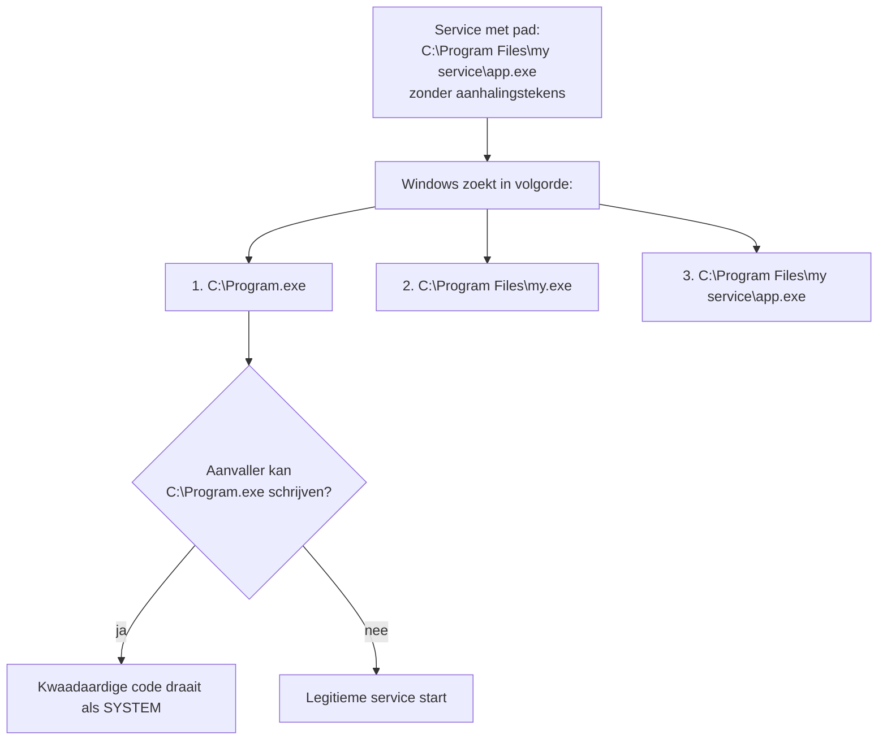

# Windows Services

Hoe Windows-services werken, hoe je ze beheert en waarom verkeerd geconfigureerde services een attack vector zijn.

## Concepts

### Architectuur & Werking van Windows Services
* **Wat is een Windows Service?** Een speciaal achtergrondprogramma dat zonder gebruikersinteractie draait. Services starten meestal automatisch bij het opstarten van het systeem, maar kunnen ook door een andere service of systeemgebeurtenis worden geactiveerd.
* **Session Zero-isolatie:** Services draaien in hun eigen geïsoleerde sessie (**Session Zero**), volledig gescheiden van de grafische gebruikerssessies (Session 1, 2, enz.) van ingelogde gebruikers.
* **Rechtencontext (*Log On As*):**
  * Veel standaardservices draaien onder het uiterst krachtige **Local System Account** (of *Local Service* / *Network Service*).
  * **Security Best Practice:** Maak voor maatwerkservices een apart serviceaccount aan volgens het principe van *"just enough privilege"* (*Principle of Least Privilege*).
* **Twee hoofdtypen services:**
  1. **`Win32OwnProcess`:** Een zelfstandig uitvoerbaar bestand (`.exe`) dat rechtstreeks door de **Service Control Manager (SCM)** wordt gestart en beheerd.
  2. **`Win32ShareProcess`:** Een service waarvan de code is ondergebracht in een **DLL** (*Dynamic Link Library*) en die samen met andere services wordt geladen binnen een gedeeld **Service Host (`svchost.exe`)**-proces.
* **Servicestatussen & Opstarttypen:**
  * **Paused vs. Stopped:** Een gepauzeerde (*Paused*) service behoudt zijn huidige statusinformatie in het geheugen voor wanneer hij wordt hervat (*Resumed*). Een gestopte (*Stopped*) service verliest alle statusinformatie en begint bij opnieuw starten helemaal "schoon".
  * **Startup Types:** *Automatic*, *Automatic (Delayed Start)* (start kort na het opstarten om de boot-snelheid te verbeteren), *Trigger Start* (sluimert totdat een specifieke gebeurtenis of service hem wekt), *Manual* en *Disabled*.

### Overzicht van Belangrijke Standaard Windows Services

| Display Name | Service Name | Functie |
| :--- | :--- | :--- |
| **Windows Update** | `wuauserv` | Controleert op en installeert Windows-updates en beveiligingspatches. |
| **Print Spooler** | `spooler` | Beheert afdruktaken en wachtrijen naar printers (bekend doelwit bij o.a. *PrintNightmare*). |
| **Windows Defender Antivirus Service** | `WinDefend` | Biedt realtime bescherming tegen virussen, malware en andere dreigingen. |
| **Background Intelligent Transfer Service** | `BITS` | Verzorgt achtergrond-bestandsoverdrachten (zoals Windows Updates en downloads). |
| **Cryptographic Services** | `CryptSvc` | Verzorgt cryptografische bewerkingen zoals encryptie, decryptie en certificaatbeheer. |
| **Windows Audio** | `Audiosrv` | Beheert audiofuncties voor weergave en opname. |
| **Task Scheduler** | `Schedule` | Plant en start taken en processen op specifieke tijdstippen of bij bepaalde triggers. |
| **Remote Desktop Services** | `TermService` | Maakt externe bureaublad- of applicatiesessies via het netwerk (RDP) mogelijk. |
| **Windows Time** | `w32time` | Synchroniseert de systeemklok met een tijdserver (NTP) binnen het netwerk. |
| **Windows Management Instrumentation** | `winmgmt` | Biedt het WMI-framework voor het beheren en bevragen van systeeminformatie. |
| **Distributed Link Tracking Client** | `TrkWks` | Houdt koppelingen tussen verplaatste of hernoemde bestanden binnen een volume bij. |
| **Windows Firewall** | `MpsSvc` | Beheert de ingebouwde Windows Defender Firewall voor inkomend en uitgaand netwerkverkeer. |
| **Windows Event Log** | `eventlog` | Beheert en registreert gebeurtenissen en fouten in de System-, Application- en Security-logs. |
| **Server** | `LanmanServer` | Verzorgt bestands- en printerdeling (SMB) voor netwerkclients. |
| **Remote Procedure Call** | `RpcSs` | Essentiële component voor inter-proces- en netwerkcommunicatie tussen systemen. |

### Windows Services als attack vector (privilege escalation)

Omdat veel Windows-services draaien met verhoogde rechten (`SYSTEM`), vormen ze een belangrijk doelwit voor lokale **Privilege Escalation** en **Persistence**. De drie belangrijkste attack vectors zijn:

1. **Unquoted Service Path:**
   * Wanneer een servicepad spaties bevat en **niet** tussen dubbele aanhalingstekens staat (bijv. `C:\Program Files\my service\WindowsService1.exe`), probeert Windows bij het starten van de service van links naar rechts telkens bij elke spatie een uitvoerbaar bestand te vinden:
     1. `C:\Program.exe`
     2. `C:\Program Files\my.exe`
     3. `C:\Program Files\my service\WindowsService1.exe`
   * Als een aanvaller schrijfrechten heeft op `C:\` of `C:\Program Files\`, kan hij een kwaadaardige `Program.exe` plaatsen die bij herstart van de service met `SYSTEM`-rechten wordt uitgevoerd.
2. **User-Writable Service Path:**
   * Wanneer de map of het uitvoerbare bestand van een legitieme service zelf schrijfbaar is voor standaardgebruikers, kan een aanvaller het originele `.exe`-bestand direct overschrijven met een kwaadaardig bestand onder dezelfde naam.
3. **User-Modifiable Service Path (Weak Service Permissions):**
   * Wanneer een standaardgebruiker rechten heeft om de configuratie van een bestaande service aan te passen (bijv. via `sc config` of het register), kan hij het `BinaryPathName` wijzigen zodat de service voortaan een kwaadaardig programma start.

* **Voorwaarden in de praktijk:** Voor een succesvolle *Unquoted Service Path*-aanval moeten meerdere factoren samenkomen: een kwetsbaar pad met spaties, schrijfrechten op een van de tussenliggende mappen, een kwaadaardige service-binary en de mogelijkheid om de service te herstarten (of te wachten op een systeemherstart).

## Commands

De commando's voor dit onderwerp staan in de referentiepagina's, met parameters en voorbeelden:

- [wmic service](/scripting/cmd#cmd-wmic-service)
- [services.msc & eventvwr.msc](/scripting/cmd#cmd-services-msc-eventvwr-msc)
- [Get-Service](/scripting/powershell#ps-get-service)
- [New-Service, Start-Service & Stop-Service](/scripting/powershell#ps-new-service-start-service-stop-service)

## Scenarios

### Scenario 1: Unquoted Service Paths Opsporen, Analyseren & Verhelpen
Een praktisch stappenplan voor systeembeheerders en SOC-analisten om kwetsbare servicepaden op te sporen, de werking van de exploit te begrijpen en het lek te dichten:

1. **Scan het systeem op kwetsbare, automatisch startende services zonder aanhalingstekens:**
   <<< @/snippets/cmd/windows-services.bat#scenario-1-stap-1{cmd}
   *(Of in PowerShell met `Get-CimInstance Win32_Service`).*
2. **Simuleer een kwetsbare service (`MyService`) in een labomgeving:**
   <<< @/snippets/ps/services.ps1#service-lab-setup{powershell}
   * Controleer via het WMIC-commando uit stap 1 dat `C:\Program Files\my service\WindowsService1.exe` nu als kwetsbaar wordt gedetecteerd.
3. **Demonstreer de kaping via `C:\Program.exe`:**
   <<< @/snippets/ps/services.ps1#service-lab-hijack{powershell}
   * *Resultaat:* Bij het starten vindt Windows eerst `C:\Program.exe` vóór de spatie in `Program Files` en voert de kwaadaardige service uit in plaats van `WindowsService1.exe`. Controleer dit in **Event Viewer** (`eventvwr.msc` → *Windows Logs → Application*, EventID `0`, Source `SimpleService`).
4. **Remediation (Het lek dichten):**
   * Open `regedit.exe` en navigeer naar `HKEY_LOCAL_MACHINE\SYSTEM\CurrentControlSet\Services\MyService`.
   * Dubbelklik op de waarde **`ImagePath`** en plaats dubbele aanhalingstekens om het volledige pad naar het uitvoerbare bestand:
     `"C:\Program Files\my service\WindowsService1.exe"`
   * Verwijder `C:\Program.exe` en herstart de service.

### Scenario 2: Vastgelopen of Verdachte Services Onderzoeken
1. **Controleer welke automatische services onverwacht niet draaien:**
   <<< @/snippets/ps/services.ps1#service-auto-not-running{powershell}
2. **Inspecteer de afhankelijkheden en herstelinstellingen:**
   * Open `services.msc`, klik met rechts op de betreffende service → **Properties**.
   * Controleer op het tabblad **Dependencies** welke onderliggende systeemcomponenten (zoals `RpcSs`) eerst moeten draaien.
   * Controleer op het tabblad **Recovery** of er bij *First/Second/Subsequent failure* een verdacht programma wordt gestart (*Run a program* is een bekende persistence-techniek voor SOC-analisten).

## References

* **Interne Commandoreferenties (SOC Analyst Map):**
  * Zie `PowerShell.md` en `CMD.md` voor het volledige overzicht van alle service-commando's (`Get-Service`, `New-Service`, `Start-Service`, `Stop-Service`, `Get-CimInstance`, `wmic service`, `sc`).
  * Zie `BASH.md` voor de Linux `systemd`-equivalenten (`systemctl`).
* **Officiële Documentatie & Security Referenties:**
  * [Microsoft Learn: Windows Services Overview](https://learn.microsoft.com/en-us/dotnet/framework/windows-services/introduction-to-windows-service-applications) — Uitleg over Session Zero, `Win32OwnProcess`, `Win32ShareProcess` en de Service Control Manager.
  * [MITRE ATT&CK T1574.009: Hijack Execution Flow — Path Interception by Unquoted Path](https://attack.mitre.org/techniques/T1574/009/) — Analyse en detectie van Unquoted Service Path-aanvallen.
  * [MITRE ATT&CK T1543.003: Create or Modify System Process — Windows Service](https://attack.mitre.org/techniques/T1543/003/) — Overzicht van persistence en privilege escalation via Windows Services.
